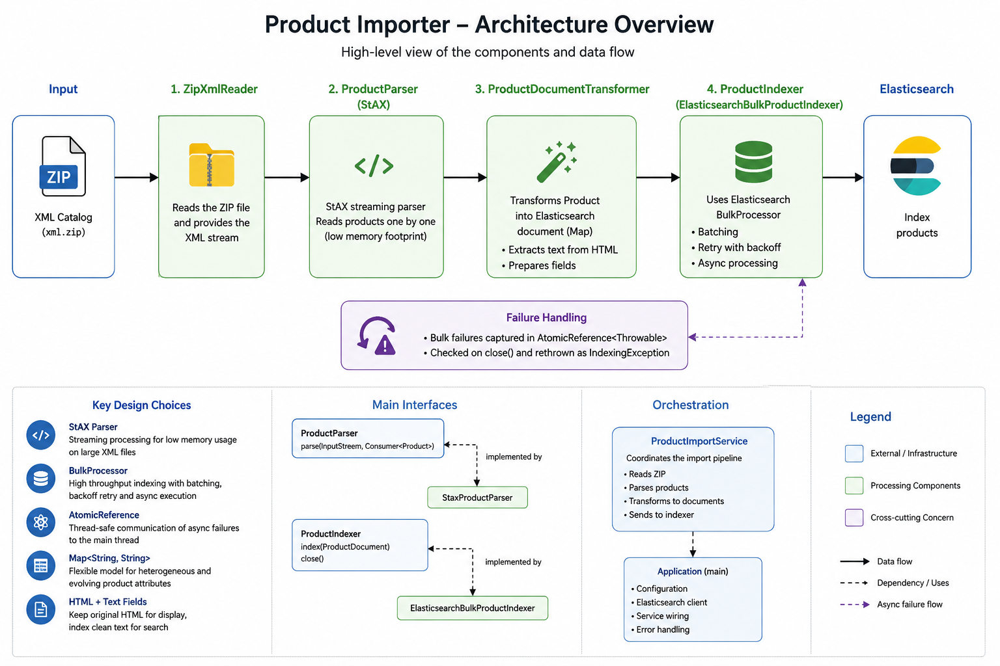
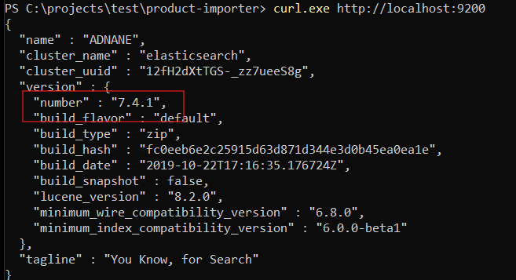
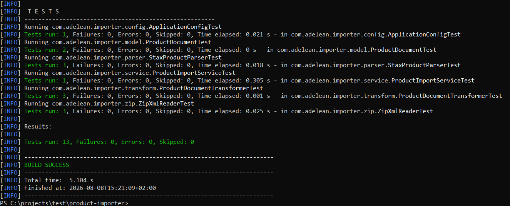
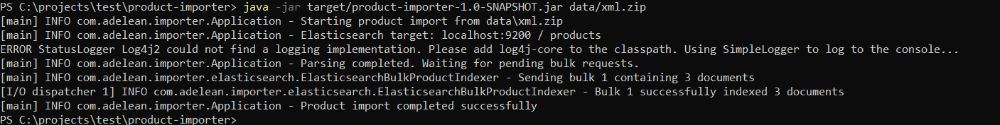
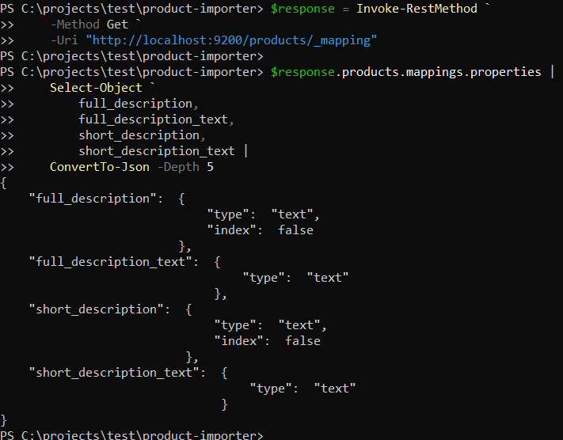
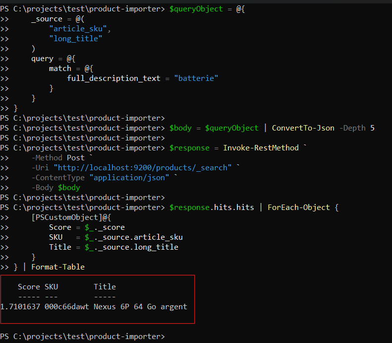

# Product Importer

Java application that imports product data from a ZIP-compressed XML file into Elasticsearch 7.4.1.

The application is designed to process large XML files in streaming mode, transform product data into search-oriented documents and index them efficiently using Elasticsearch bulk operations.

---

## Features

- Reads an XML file directly from a ZIP archive
- Parses products incrementally using StAX
- Does not load the complete catalog into memory
- Preserves heterogeneous product attributes
- Keeps original HTML descriptions while generating searchable plain-text versions
- Creates the Elasticsearch index and mapping automatically
- Uses Elasticsearch `BulkProcessor` for asynchronous batch indexing
- Handles asynchronous bulk failures and propagates them to the main application flow
- Provides unit and pipeline tests
- Uses externalized Elasticsearch configuration

---

## Architecture



The application is organized around a streaming import pipeline:

```text
XML ZIP
  │
  ▼
ZipXmlReader
  │
  ▼
ProductParser
  │
  └── StaxProductParser
  │
  ▼
ProductDocument
  │
  ▼
ProductDocumentTransformer
  │
  ▼
ProductIndexer
  │
  └── ElasticsearchBulkProductIndexer
  │
  ▼
Elasticsearch 7.4.1
```

`ProductImportService` coordinates the import workflow, while `Application` is responsible for application startup, configuration and dependency wiring.

### Main components

| Component | Responsibility |
|---|---|
| `Application` | Entry point, configuration, lifecycle and dependency wiring |
| `ApplicationConfig` | Loads Elasticsearch configuration |
| `ZipXmlReader` | Reads the XML stream directly from the ZIP archive |
| `ProductParser` | Parsing abstraction |
| `StaxProductParser` | Streaming XML parser implementation |
| `ProductDocument` | Internal representation of a product |
| `ProductDocumentTransformer` | Prepares product data for indexing |
| `ProductIndexer` | Indexing abstraction |
| `ElasticsearchBulkProductIndexer` | Bulk Elasticsearch implementation |
| `ProductIndexManager` | Creates and configures the Elasticsearch index |
| `ProductImportService` | Coordinates ZIP → parse → transform → index |

For the rationale behind the main architectural and implementation choices, see:

**[TECHNICAL_DECISIONS.md](TECHNICAL_DECISIONS.md)**

---

## Requirements

- Java 11
- Maven
- Elasticsearch 7.4.1

The project was tested with Elasticsearch:

```text
7.4.1
```

Verify that Elasticsearch is running:

```powershell
curl.exe http://localhost:9200
```

Expected version:

```json
{
  "version": {
    "number": "7.4.1"
  }
}
```

---

## Configuration

Elasticsearch configuration is located in:

```text
src/main/resources/application.properties
```

Default configuration:

```properties
elasticsearch.host=localhost
elasticsearch.port=9200
elasticsearch.index=products
```

---

## Build

Run the automated tests:

```powershell
mvn clean test
```

Build the executable JAR:

```powershell
mvn clean package
```

Expected result:

```text
BUILD SUCCESS
```

The generated executable JAR is:

```text
target/product-importer-1.0-SNAPSHOT.jar
```

---

## Run

Make sure Elasticsearch 7.4.1 is running.

Then execute:

```powershell
java -jar target/product-importer-1.0-SNAPSHOT.jar data/xml.zip
```

Example output:

```text
[main] INFO com.adelean.importer.Application - Starting product import from data\xml.zip
[main] INFO com.adelean.importer.Application - Elasticsearch target: localhost:9200 / products
[main] INFO com.adelean.importer.Application - Parsing completed. Waiting for pending bulk requests.
[main] INFO com.adelean.importer.elasticsearch.ElasticsearchBulkProductIndexer - Sending bulk 1 containing 3 documents
[I/O dispatcher 1] INFO com.adelean.importer.elasticsearch.ElasticsearchBulkProductIndexer - Bulk 1 successfully indexed 3 documents
[main] INFO com.adelean.importer.Application - Product import completed successfully
```

---

## Verify the Import

### Count indexed documents

```powershell
curl.exe http://localhost:9200/products/_count
```

With the provided dataset:

```json
{"count":3,"_shards":{"total":1,"successful":1,"skipped":0,"failed":0}}
```

---

## Elasticsearch Mapping

The application explicitly maps the main searchable and identifier fields.

Examples:

```text
article_sku             keyword
brand                   keyword
brand_reference         keyword
category                keyword
ean13                   keyword

long_title              text
short_title             text

full_description        stored, not indexed
short_description       stored, not indexed

full_description_text   text
short_description_text  text
```

Additional product-specific attributes are accepted through Elasticsearch dynamic mapping.

Inspect the complete mapping with:

```powershell
curl.exe "http://localhost:9200/products/_mapping?pretty"
```

---

## HTML Descriptions and Search

The source XML contains HTML descriptions.

The application keeps the original HTML fields:

```text
full_description
short_description
```

but configures them with:

```json
"index": false
```

They remain available in Elasticsearch `_source`, but are intentionally excluded from full-text search.

Searchable plain-text representations are generated:

```text
full_description_text
short_description_text
```

### Raw HTML field

Searching the original field:

```powershell
$body = @{
    query = @{
        match = @{
            full_description = "batterie"
        }
    }
} | ConvertTo-Json -Depth 5

Invoke-RestMethod `
    -Method Post `
    -Uri "http://localhost:9200/products/_search" `
    -ContentType "application/json" `
    -Body $body
```

returns:

```text
Cannot search on field [full_description] since it is not indexed.
```

This is the expected behavior.

### Searchable text field

Use the generated text field instead:

```powershell
$body = @{
    _source = @(
        "article_sku",
        "long_title",
        "full_description_text"
    )

    query = @{
        match = @{
            full_description_text = "batterie"
        }
    }
} | ConvertTo-Json -Depth 5

$response = Invoke-RestMethod `
    -Method Post `
    -Uri "http://localhost:9200/products/_search" `
    -ContentType "application/json" `
    -Body $body

$response.hits.hits | ForEach-Object {
    [PSCustomObject]@{
        Score = $_._score
        SKU   = $_._source.article_sku
        Title = $_._source.long_title
    }
} | Format-Table
```

Example result:

```text
Score      SKU         Title
-----      ---         -----
1.7101637  000c66dawt  Nexus 6P 64 Go argent
```

---

## Tests

Run:

```powershell
mvn clean test
```

The test suite covers:

- ZIP XML extraction
- missing XML entries
- product document behavior
- streaming XML parsing
- multiple products
- CDATA handling
- empty XML fields
- HTML-to-text transformation
- application configuration
- complete import pipeline

The complete pipeline is tested without requiring Elasticsearch by using an in-memory implementation of `ProductIndexer`.

```text
ProductImportService
        │
        ▼
ProductIndexer
        │
        ├── ElasticsearchBulkProductIndexer
        │        production
        │
        └── InMemoryProductIndexer
                 tests
```

---

## Validation Screenshots

### Elasticsearch 7.4.1



### Automated Tests



### Successful Import



### Indexed Product Count


### Elasticsearch Mapping



### Full-text Search



---

## Error Handling

The application distinguishes the main failure categories:

```text
ConfigurationException
XmlParsingException
IndexingException
```

The command-line entry point maps them to dedicated exit codes:

```text
1 → unexpected error
2 → configuration error
3 → XML parsing error
4 → Elasticsearch indexing error
5 → invalid command-line argument
```

Bulk indexing failures can occur asynchronously. The application stores such failures and verifies them before reporting the import as successful.

The detailed reasoning behind this mechanism is documented in:

**[TECHNICAL_DECISIONS.md](TECHNICAL_DECISIONS.md)**

---

## Project Structure

```text
product-importer/
│
├── README.md
├── TECHNICAL_DECISIONS.md
├── pom.xml
│
├── data/
│   └── xml.zip
│
├── docs/
│   ├── architecture.png
│   └── screenshots/
│
└── src/
    ├── main/
    │   ├── java/com/adelean/importer/
    │   │   ├── Application.java
    │   │   ├── config/
    │   │   ├── elasticsearch/
    │   │   ├── exception/
    │   │   ├── indexing/
    │   │   ├── model/
    │   │   ├── parser/
    │   │   ├── service/
    │   │   ├── transform/
    │   │   └── zip/
    │   │
    │   └── resources/
    │       └── application.properties
    │
    └── test/
        └── java/com/adelean/importer/
```

---

## Technical Decisions

The README intentionally focuses on setup, execution, architecture and validation.

The detailed explanations of the main design choices are documented separately:

**[TECHNICAL_DECISIONS.md](TECHNICAL_DECISIONS.md)**

It covers in particular:

- Why StAX was selected
- Why `BulkProcessor` is used
- Why `AtomicReference` is used for asynchronous failures
- Why product attributes are represented with `Map<String, String>`
- Why both HTML and plain-text description fields are kept
- Why `ProductParser` and `ProductIndexer` interfaces were introduced
- Why the import orchestration is isolated in `ProductImportService`

---

## Technologies

- Java 11
- Maven
- Elasticsearch 7.4.1
- Elasticsearch High Level REST Client
- Elasticsearch BulkProcessor
- StAX
- Jsoup
- JUnit 5
- SLF4J

---

## Summary

The application implements the following streaming pipeline:

```text
ZIP
 ↓
XML InputStream
 ↓
StAX
 ↓
ProductDocument
 ↓
HTML/search transformation
 ↓
BulkProcessor
 ↓
Elasticsearch 7.4.1
```

The implementation avoids loading the complete catalog into memory, keeps the import workflow separated from the underlying parsing and indexing technologies, and validates the complete processing chain through automated tests.